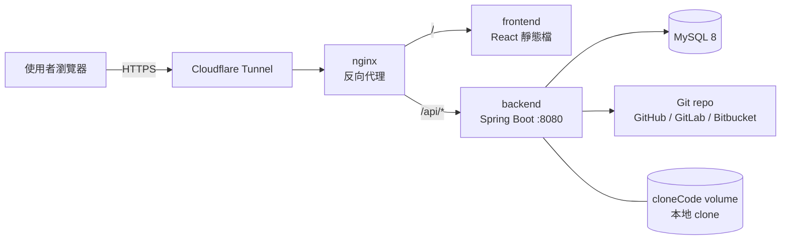
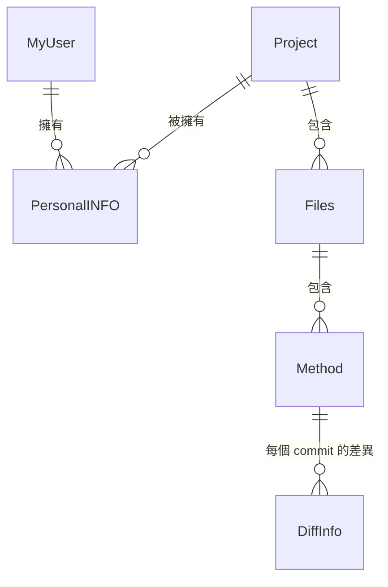
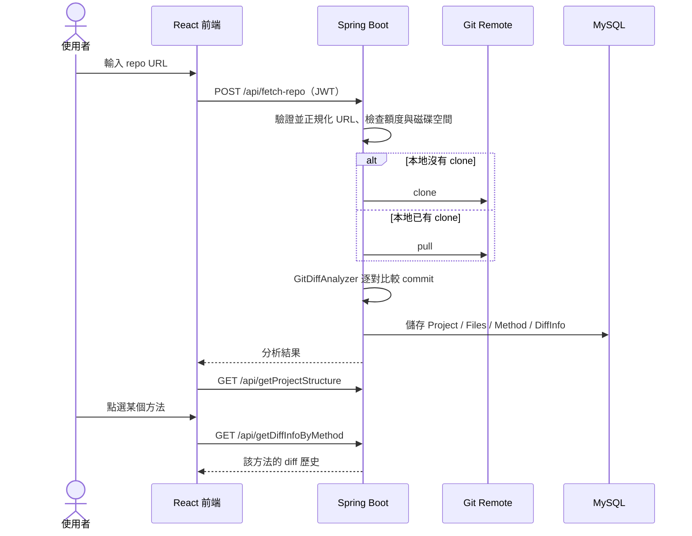
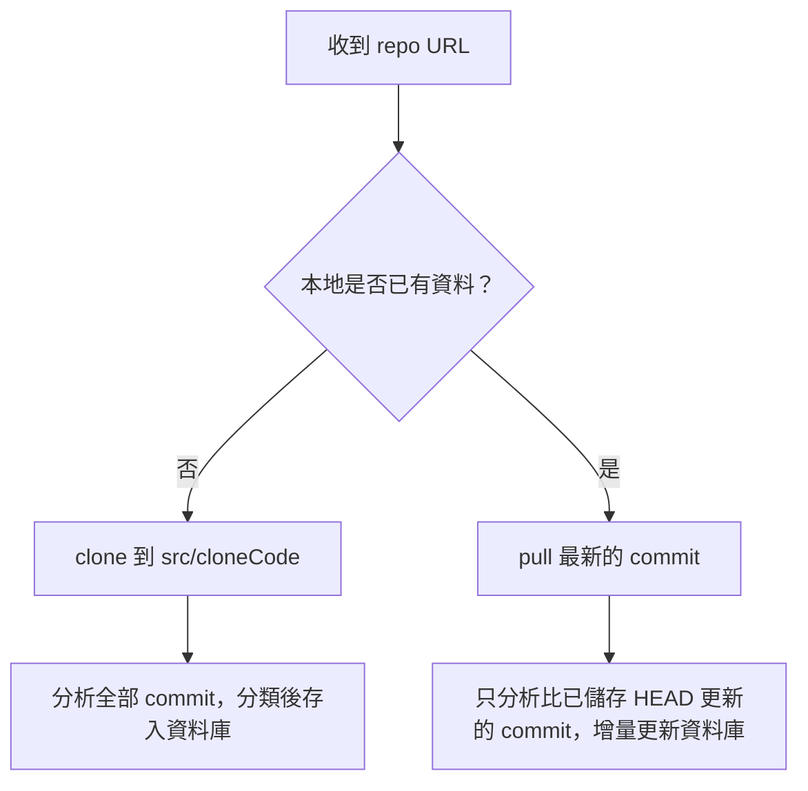
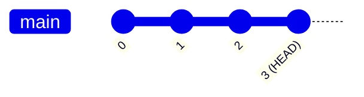
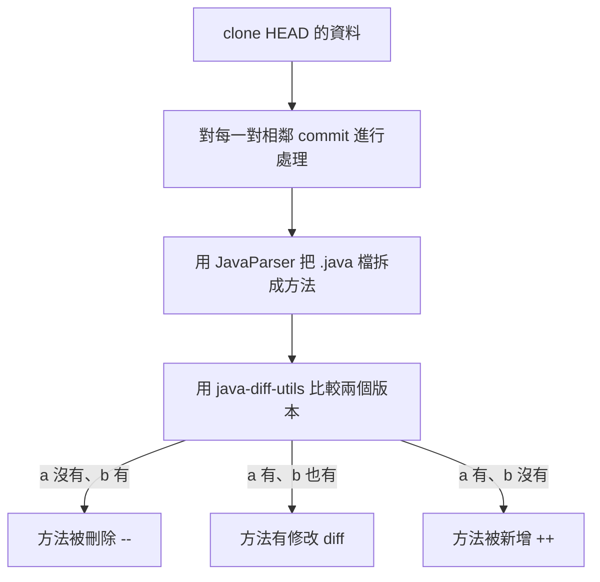
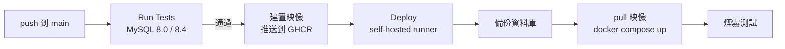

<div align="center">

# CodeManageSystem

**把 Git 的「檔案層級」比對，細化成「方法層級」的程式碼演化追蹤系統**

[](https://github.com/ruserxd/CodeManageSystem_ForNSTCproject/actions/workflows/backend_test.yml)
[](https://github.com/ruserxd/CodeManageSystem_ForNSTCproject/actions/workflows/deploy.yml)
[](LICENSE)


國科會大專學生研究計畫（NSTC 113-2813-C-035-131-E）・2025 台灣軟體工程研討會（TSEC）展示論文

</div>

---

<!-- TODO: 放一段 10–20 秒的操作 GIF：輸入 repo URL → 展開檔案 → 點方法 → 看到 diff 歷史 -->
<!--  -->

## 目錄

- [簡介](#簡介)
- [功能特色](#功能特色)
- [畫面展示](#畫面展示)
- [系統架構](#系統架構)
- [技術棧](#技術棧)
- [快速開始](#快速開始)
- [核心流程](#核心流程)
- [API 一覽](#api-一覽)
- [測試與 CI/CD](#測試與-cicd)
- [專案結構](#專案結構)
- [Roadmap](#roadmap)
- [致謝](#致謝)
- [授權](#授權)

## 簡介

`git diff` 告訴你「哪個檔案改了哪幾行」，但在閱讀程式碼歷史時，我們真正關心的通常是「**這個方法**經歷過哪些修改」。

CodeManageSystem 會 clone 使用者指定的 Git repo，走過每一個 commit，用 **JavaParser** 把每個 `.java` 檔拆成方法，再用 **java-diff-utils** 比對相鄰 commit 之間每個方法的差異，最後把每個方法的完整演化歷史存進資料庫，在前端以方法為單位呈現。

## 功能特色

- **方法層級的 diff**：每個方法都有自己的修改歷史，可以分辨新增、刪除、修改
- **專案管理**：輸入 GitHub / GitLab / Bitbucket 的 repo URL 即可分析；已分析過的專案可以 pull 做增量更新
- **自動化部署**：GitHub Actions 測試 → 推送映像到 GHCR → self-hosted runner 部署到實驗室主機，透過 Cloudflare Tunnel 對外提供 HTTPS

## 畫面展示

| 登入 / 訪客模式 | 專案列表 | 方法 diff 歷史 |
|:---:|:---:|:---:|
| _（截圖待補）_ | _（截圖待補）_ | _（截圖待補）_ |

## 系統架構



所有服務都由 `docker-compose.yml` 管理。瀏覽器只會連到 nginx：前端靜態檔由 nginx 提供，`/api/*` 轉給後端，所以前後端同源，不需要另外處理 CORS。

### 資料模型



前端會先載入專案結構（Project → Files → Method），點到某個方法時才抓那個方法的 `DiffInfo`，不會一次拉整個專案的資料。

## 技術棧

| 分類 | 技術 |
|---|---|
| 前端 | React 18、Vite 6、Ant Design 5、React Router 6、axios、react-syntax-highlighter、Yarn 4 |
| 後端 | Spring Boot 3.4、Java 21、Spring Security（OAuth2 Resource Server / JWT HS256）、Spring Data JPA、Flyway |
| 程式碼分析 | JGit、JavaParser、java-diff-utils |
| 資料庫 | MySQL 8 |
| 測試 | JUnit 5、Mockito、Testcontainers、JaCoCo、PMD |
| 部署 | Docker（多階段建置）、Docker Compose、nginx、Cloudflare Tunnel、GHCR |
| CI/CD | GitHub Actions（MySQL 8.0 / 8.4 matrix 測試、self-hosted runner 部署） |

## 快速開始

### 方法一：Docker Compose（推薦）

需要 Docker Engine 與 Compose v2。

```bash
git clone https://github.com/ruserxd/CodeManageSystem_ForNSTCproject.git
cd CodeManageSystem_ForNSTCproject

cp .env.example .env
# 編輯 .env，至少填入 DOCKER_DATASOURCE_*、JWT_SECRET（至少 32 字元）

docker compose up --build -d
```

啟動後開啟 <http://localhost>。後端與前端的 Dockerfile 都是多階段建置，不需要先在本機執行 Maven 或 Yarn。

> 要直接使用 CI 建好的映像，可以改用 `docker compose pull && docker compose up -d`。`.env` 的 `IMAGE_TAG` 可以指定某個 commit SHA，用來回退版本。

### 方法二：本機開發

**後端**（需要 JDK 21 與一個 MySQL 8）

```bash
cd backend
# 依 .env.example 的「本機開發用」區塊設定環境變數
./mvnw spring-boot:run
```

後端必須以 `backend/` 作為工作目錄啟動（clone 路徑 `src/cloneCode` 是相對路徑）。使用 IntelliJ 的話，可以安裝 EnvFile 外掛，在 Run Configurations 勾選 Enable EnvFile 並指定 `.env`：


**前端**（需要 Node.js 與 Yarn 4）

```bash
cd frontend
yarn install
yarn dev        # http://localhost:3000
```

### 主要環境變數

完整說明見 [`.env.example`](../.env.example)。

| 變數 | 說明 |
|---|---|
| `SPRING_DATASOURCE_URL` / `USERNAME` / `PASSWORD` | 本機開發用的資料庫連線 |
| `DOCKER_DATASOURCE_URL` / `USERNAME` / `PASSWORD` | Docker Compose 用的資料庫連線 |
| `JWT_SECRET` | JWT 簽章金鑰，至少 32 bytes，太短後端會啟動失敗 |
| `APP_ADMIN_ACCOUNT` / `APP_ADMIN_PASSWORD` | 啟動時建立管理員帳號（留空則不建立） |
| `APP_DEMO_ACCOUNT` / `APP_DEMO_PASSWORD` / `APP_DEMO_REPOS` | 訪客模式帳號與預先匯入的範例 repo |
| `APP_QUOTA_DAILY_*` | 每日註冊與分析額度 |
| `APP_LIMITS_*` | 單次分析的 commit 上限、每人專案數上限、最低可用磁碟空間 |
| `VITE_API_URL` | 前端呼叫的 API 位址，build 時寫死；Compose 部署請留空（同源） |

## 核心流程

### 一次分析請求



### Git Cloner



### Git Diff Analyzer

從 HEAD 開始，往回逐對比較相鄰的 commit：



比較順序為 `3 ↔ 2`、`2 ↔ 1`、`1 ↔ 0`。每一對 commit 的處理方式如下（a 為較新的版本，b 為較舊的版本）：



## API 一覽

所有 endpoint 都在 `/api` 底下。除了登入、註冊、訪客登入以外都需要 JWT（`Authorization: Bearer <token>`），使用者身分一律從 token 取得。

| Method | Endpoint | 說明 | 權限 |
|---|---|---|---|
| POST | `/login` | 登入，回傳 JWT | 公開 |
| POST | `/register` | 註冊 | 公開 |
| POST | `/demo-login` | 訪客登入 | 公開 |
| POST | `/fetch-repo` | clone 並分析 repo，存入資料庫 | 使用者 |
| POST | `/get-method-diff-temporary` | 臨時分析，不存資料庫 | 使用者 |
| GET | `/pullProject` | pull 並增量分析 | 使用者（擁有者） |
| GET | `/getProjectNames` | 取得自己的專案列表 | 使用者 |
| GET | `/getProjectStructure` | 取得專案的檔案與方法結構 | 使用者（擁有者） |
| GET | `/getDiffInfoByMethod` | 取得單一方法的 diff 歷史 | 使用者（擁有者） |
| POST | `/getData` | 取得專案資料 | 使用者（擁有者） |
| GET | `/deleteData` | 移除專案 | 使用者（擁有者） |
| GET | `/getAllUsers` | 列出所有使用者 | ADMIN |
| POST | `/deleteUser` | 刪除使用者 | ADMIN |
| GET | `/addSuperAccount` | 建立管理員帳號 | ADMIN |

## 測試與 CI/CD

```bash
cd backend
./mvnw test            # 全部測試
./mvnw verify          # 測試 + JaCoCo 覆蓋率報告（target/site/jacoco）
./mvnw pmd:check       # 靜態分析
```

- 測試以 Mockito 單元測試為主；`FlywaySchemaValidationTest` 會用 Testcontainers 啟動空的 MySQL，驗證 Flyway migration 與 Hibernate schema（本機沒有 Docker 時會略過，CI 中略過會直接失敗）。
- 部署流程：



實驗室主機的一次性設定見 [DEPLOY.md](DEPLOY.md)。

## 專案結構

```text
.
├── backend/                  # Spring Boot 後端
│   └── src/main/java/com/codemangesystem/
│       ├── ApiController.java    # 唯一的 REST controller
│       ├── git_process/          # clone、pull、方法層級 diff 分析
│       ├── login_process/        # 註冊、登入、JWT
│       └── config/               # Spring Security 等設定
├── frontend/                 # React + Vite 前端
│   └── src/
│       ├── api/                  # axios 設定（自動帶 JWT）
│       └── components/diff/      # 方法 diff 檢視元件
├── nginx/                    # 反向代理設定
├── docs/                     # 文件（ROADMAP、PROGRESS、DEPLOY、ADR）
├── .github/workflows/        # CI（測試、發佈映像）與 CD（部署）
├── docker-compose.yml
└── .env.example
```

## Roadmap
接下來會加入以本地 LLM 為核心的程式碼歷史分析功能（方法變更摘要、修改分類、演化敘事、語意搜尋、歷史問答），並遷移到 Kubernetes。

- [ ] Python FastAPI LLM 服務
- [ ] Kubernetes 部署

完整規劃見 [ROADMAP.md](ROADMAP.md)，實際進度見 [PROGRESS.md](PROGRESS.md)。程式碼風格見 [style_guide.md](style_guide.md)。

## 致謝

1. 國科會大專學生研究計畫補助，計畫編號：**NSTC 113-2813-C-035-131-E**
2. **2025 台灣軟體工程研討會**展示論文

## 授權

本專案採用 MIT 授權條款，詳見 [LICENSE](LICENSE)。
